# Generating Data by Climbing a Fixed Landscape

*A geometric introduction to Gaussian perturbations, diffusion, and noise unconditioning.*

Images appear from a sentence. Videos appear from a sketch. Diffusion models have become a central language of generative AI, and their ideas now reach into scientific design, robot policies, and emerging approaches to language generation. It is an exciting time to enter the field. It can also be a surprisingly exhausting one.

Open the DDPM paper [[4]](https://arxiv.org/abs/2006.11239), and a simple ambition—generate a new image—soon becomes a page of conditional distributions. Follow the score-based route, and the explanation eventually arrives at a time-reversed stochastic differential equation (SDE) [[5]](https://arxiv.org/abs/2011.13456). To understand why a deterministic ordinary differential equation (ODE) can describe the same evolving distributions, we encounter an equation for how an entire probability density changes. Some formulations of controllable generation add stochastic optimal control to the reading list.

For a reader already at home with these tools, the framework is elegant. For an application researcher with a promising idea and no background in SDEs, the entrance fee is substantial. One can run the code long before one can comfortably reason about what it is doing. Between “add noise, then remove it” and the full mathematical machinery, there is a large gap where useful intuition ought to live.

We would like to build an explanation that starts inside that gap. We begin with the purpose of generation, recover the difficulty that originally motivated noise-conditional score networks, and then follow two parallel responses to it. One leads to the familiar sequence of noise-conditioned distributions. The other combines the same Gaussian perturbations into one fixed density landscape.

On that landscape, generation becomes something familiar: start from a random location and climb uphill. In optimization, this is called **gradient ascent**: repeatedly move a point in the direction that increases a fixed objective. Here the objective is log density, and the point being optimized is the sample we want to generate.

The picture is simple enough to draw, but it raises serious questions. Why should the hills lead toward meaningful data? Why should different climbers end up in different places? And why should the destination ever be a new sample rather than a copy of the training set?

We will build the picture in that order: first construct the terrain with Gaussian perturbations, then follow its gradients toward the data. Once we understand where the climbers go, we can ask whether different starting points retain different outcomes. That is the additional demand of generation: finding a good solution is only part of the job; a useful generator must also preserve diversity.

## 1. Generation starts with an unknown distribution

Let us temporarily forget everything we know about diffusion. We want to generate an object that could plausibly belong to a real data distribution, which we denote by $p_{\mathrm{data}}$. For an image model, a point $x\in\mathbb R^d$ might contain all the pixel values of an image. A generated point should look like a sample from that unknown distribution.

What we actually have is a training set $\{\mu_j\}_{j=1}^M$, where $\mu_j$ is the $j$th observed example and $M$ is the number of examples. Its empirical distribution is

$$
p^*(x)=\frac{1}{M}\sum_{j=1}^M\delta(x-\mu_j).
$$

Each delta places probability mass at one observed sample. With a finite training set, sampling from $p^*$ simply means choosing one of those samples. A useful generator should recover information about the underlying population beyond this finite list.

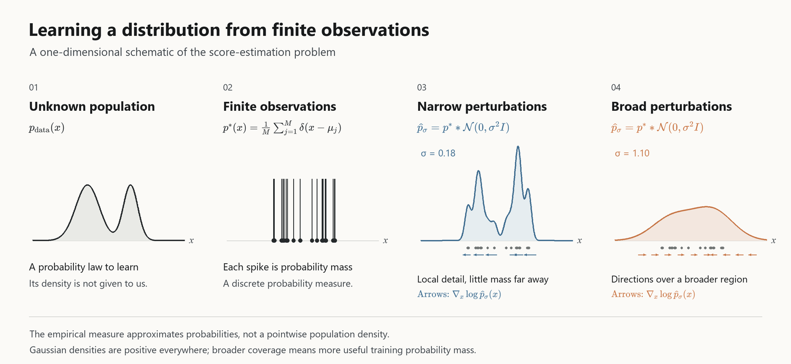

*Figure 1. The population is unknown; the observations are finite. Gaussian perturbation turns isolated empirical atoms into a density with gradients. This one-dimensional schematic illustrates the statistical objects, rather than the geometry of high-dimensional images.*

A density describes probability per unit volume; adding it over a region gives that region's probability. We could try to learn this density directly. But for generation, another quantity is especially convenient: its **score**,

$$
s(x)=\nabla_x\log p(x).
$$

The score tells us which direction locally increases the log density. The normalizing constant—the factor that makes total probability equal to one—disappears when we differentiate its logarithm. Learning the direction can therefore be easier than learning the normalized density.

If we already had a reliable score throughout the region we wanted to traverse, it would provide a natural guide toward more plausible states. The word “throughout” is where the difficulty begins.

## 2. A useful direction is missing where we need it

Real images occupy a very small part of the full pixel space. A randomly chosen array of pixel values is almost certainly noise: meaningful pixels cannot vary independently. Imagine a curved sheet inside a much larger space, with only a few independent directions of variation along it. We call such a sheet a **manifold**, and the number of its local directions its intrinsic dimension. The manifold hypothesis says that meaningful data concentrate near a set of this kind, with intrinsic dimension much smaller than $d$.

**Score matching** is a training principle for learning this gradient field [[6]](https://jmlr.org/papers/v6/hyvarinen05a.html). It learns from the places where training examples occur. A generator, however, begins far away and has to travel toward them. There may be very little training information along this journey. If the population lies exactly on a lower-dimensional manifold, an ordinary density in the full space and its score are not even defined in the usual way. If it instead has a density concentrated in a very thin neighborhood, training coverage away from the data can still be extremely poor.

The empirical distribution makes this issue impossible to ignore. A sum of delta masses provides no ordinary score field between its atoms. We have observed the destinations, but have learned almost nothing about the roads that lead to them.

Gaussian perturbation supplies those roads. Add independent Gaussian noise with standard deviation $\sigma$ to every coordinate of a training point. Averaging over the training set gives the smooth density

$$
\widehat p_\sigma(x)=\frac{1}{M}\sum_{j=1}^M\mathcal N(x;\mu_j,\sigma^2I).
$$

Here $I$ is the identity matrix: $\sigma^2I$ means that the coordinate noises are independent and have the same variance $\sigma^2$.

Each training point becomes a Gaussian cloud. But in high dimensions, a cloud is a misleading picture if we imagine its samples spread evenly throughout a ball. Write a noisy example as $X=\mu_j+\sigma\varepsilon$, where $\varepsilon\sim\mathcal N(0,I)$. Its distance from the clean example is typically

$$
\|X-\mu_j\|\approx\sigma\sqrt d.
$$

Most draws lie in a relatively thin layer around this radius: a **Gaussian shell**. We can make “most” concrete by choosing a shell containing **99.7% of Gaussian perturbations**—the high-dimensional analogue of the familiar three-sigma region. In high dimensions, the radius is centered near $\sigma\sqrt d$, with a radial standard deviation of about $\sigma/\sqrt2$ [[1]](https://arxiv.org/abs/2601.19285). Thus its approximate three-standard-deviation band is

$$
\sigma\sqrt d-\frac{3\sigma}{\sqrt2}
\;\lesssim\;\|X-\mu_j\|\;\lesssim\;
\sigma\sqrt d+\frac{3\sigma}{\sqrt2}.
$$

The shell's thickness grows in proportion to $\sigma$, while its radius grows as $\sigma\sqrt d$. The larger the dimension, the thinner it becomes relative to its radius. A single noise level therefore supplies almost all its training examples within one narrow band of distances from each clean example. The figure uses radial quantiles to set the shell boundaries at exactly 99.7% probability, rather than relying on the large-dimension approximation above.

Changing $\sigma$ moves this band. Small noise supplies examples close to the data, where fine structure matters. Large noise supplies examples farther away, where generation begins. To learn directions along the journey between them, we use many noise levels from $\sigma_{\min}$ to $\sigma_{\max}$, choosing neighboring levels close enough that their typical shells overlap. Repeated around all the training points, these overlapping bands connect the broad noisy region to the neighborhoods of the data manifold.

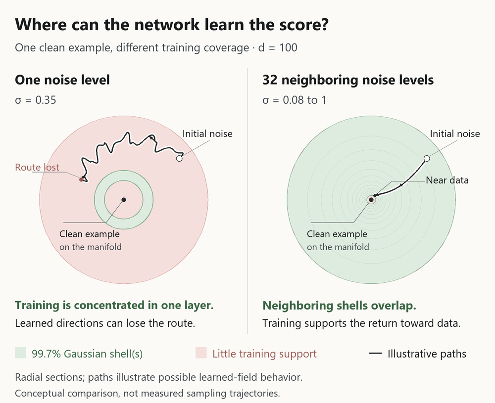

*A radial cross-section of high-dimensional shells around one clean example. Each green shell contains the central 99.7% of the corresponding Gaussian's radial probability, computed at $d=100$; pale red marks the remaining displayed regions. On the left, inaccurate learned directions make the illustrative path wander away from the data. On the right, 32 overlapping shells support a coherent return to the fine-noise neighborhood. These paths are conceptual illustrations, not measured neural-network trajectories.*

Every Gaussian with $\sigma>0$ already has positive density everywhere. These 99.7% shells give an operational meaning to **effective training coverage**: where almost all Gaussian training draws, and therefore most of the available supervision, are concentrated. Overlapping scales extend that supervision throughout the broad-to-fine region that sampling is intended to traverse. The boundary is a probability convention, not a hard limit on the Gaussian's support or a guarantee that the learned score is accurate at every point inside it.

The radial version of the three-sigma rule

The one-dimensional three-sigma rule concerns a scalar Gaussian. Here the scalar quantity is the distance $R=\|X-\mu_j\|$, whose distribution satisfies $R/\sigma\sim\chi_d$. Its radial standard deviation approaches $\sigma/\sqrt2$ as $d$ grows. The displayed shell uses the 0.15% and 99.85% quantiles of this radial distribution, giving exactly 99.7% probability. At $d=100$, its boundaries are approximately $7.9484\sigma$ and $12.1328\sigma$. In a finite batch of Gaussian perturbations, the expected fraction in this shell is 99.7%; the realized fraction fluctuates.

When the largest perturbation is broad relative to the data's spread, its overlapping clouds can be close to a simple Gaussian. This gives generation a convenient starting distribution. The approximation has a cost, which will appear explicitly as initialization mismatch when we discuss probability coverage.

This is the problem that motivated the multi-scale construction in NCSN. The noise levels bridge a gap in learning: we need useful directions along the route, as well as near the destination [[3]](https://arxiv.org/abs/1907.05600).

## 3. The Gaussian construction has two parallel routes

With training examples now spread across these regions, the next choice is whether to tell the network which noise level produced each example. The familiar route keeps that information visible. A noise-conditional score network receives both $x$ and $\sigma_i$ and learns

$$
s_\theta(x,\sigma_i)\approx\nabla_x\log\widehat p_{\sigma_i}(x).
$$

At these discrete scales, $\widehat p_{\sigma_i}$ is the distribution denoted by $p_i^*$ in our smoothing paper [[1]](https://arxiv.org/abs/2601.19285).

The learning target is practical because we create the corruption ourselves. For $x=\mu_j+\sigma_i\varepsilon$, with $\varepsilon\sim\mathcal N(0,I)$, the component score is the known vector $(\mu_j-x)/\sigma_i^2$. The trainer knows the clean center and the perturbation. At a fixed noise level, regressing on these vectors averages over the possible clean centers compatible with a noisy input, yielding the score of that perturbed mixture. This is denoising score matching: supervision comes from a Gaussian perturbation whose direction we know [[7]](https://doi.org/10.1162/NECO_a_00142).

Generation uses the scores in a sequence from broad noise toward fine structure. At a fixed scale, an uphill score step can be combined with random jitter. With suitable steps and enough mixing, this balance targets the whole distribution rather than only its density peaks. This is **Langevin dynamics**; repeating it while gradually reducing the noise is the annealed version used by noise-conditional score networks (NCSNs) [[3]](https://arxiv.org/abs/1907.05600).

Reverse-time SDEs later supplied a unified distributional account of score-based diffusion. They also lead to deterministic paths whose particle positions have the same distribution at each time as the corresponding diffusion, under the exact-score assumptions. This deterministic construction is called the **probability-flow ODE** [[5]](https://arxiv.org/abs/2011.13456). These results explain how the changing distributions fit together. Ordinary ascent on one fixed density needs a separate probability argument, which we will develop for the unconditioned route.

There is another response to the same coverage problem. We can collect all the perturbed distributions into one density, learn its score, and let the current position determine which parts of the construction matter. This is **noise unconditioning** [[1]](https://arxiv.org/abs/2601.19285) [[2]](https://arxiv.org/abs/2611.22202).

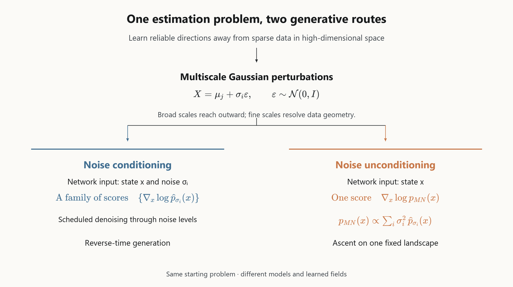

*Figure 2. Both routes use Gaussian perturbations to improve training coverage. Conditioning learns a family of fields and supplies a noise label during generation. Unconditioning learns the score of one weighted mixture and follows a field that depends only on the current state.*

The two routes learn different fields. Removing a noise input during training changes the regression target. In particular, the fixed field below is not an algebraic rewriting of every time-dependent diffusion sampler [[1]](https://arxiv.org/abs/2601.19285).

This distinction gives us a useful freedom: we can turn the same broad-to-fine training coverage into one fixed optimization objective.

## 4. Gaussian shells build a mountain

The shells have explained where training examples are available. To understand the terrain, we now ask how much probability is packed into how much volume. Return to one center $\mu$, and draw the same number of noisy examples at each scale.

The shells at different scales contain approximately the same fraction of their respective Gaussian components. Yet their volumes are extraordinarily different. Doubling the scale multiplies the volume of a corresponding shell by $2^d$. With the same number of draws spread across that much more space, the larger shell has much lower average density.

**Explore the geometry.** [Open the interactive illustration](gaussian-landscape.html) to vary dimension, noise scales, and step size while moving from shells to mountains and ascent trajectories.

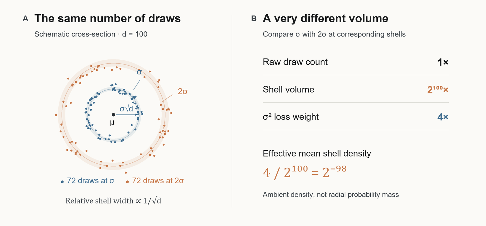

*Figure 3. Shells are shown in cross-section. Equal draw counts refer to the unweighted training procedure. The loss weighting used below gives a scale twice as large four times the effective mixture mass, while its corresponding shell volume grows by $2^d$. At $d=100$, the shell-average density ratio is still $2^{-98}$.*

The weighting deserves attention because it will matter again later. To balance regression errors across noise scales, the denoising training objective weights each squared error by $\sigma^2$. We will write that objective in the next section. Its effective mixture mass grows as $\sigma^2$, while the shell volume grows as $\sigma^d$. Their ratio therefore scales as $\sigma^{2-d}$. In high dimensions, the volume effect easily dominates [[1]](https://arxiv.org/abs/2601.19285) [[3]](https://arxiv.org/abs/1907.05600).

This is the geometric origin of the mountain picture: broad scales provide the foothills, and smaller scales provide increasingly concentrated density near the center. For one center, the mixture is radially decreasing away from $\mu$, with its peak exactly at $\mu$.

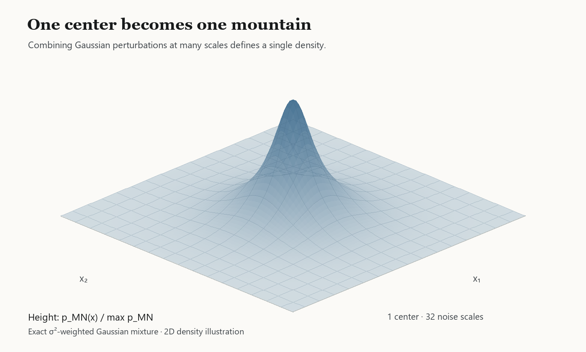

*Figure 4. A multi-scale density landscape in two dimensions, with height normalized by its maximum. Density and log density have the same uphill directions. The high-dimensional shell argument explains the concentration mechanism; this low-dimensional surface makes the resulting hill easy to see.*

There is no contradiction between a Gaussian having its highest density at the center and most of its probability mass lying on a shell. A shell has enormous volume. **Mountain height represents density, not the probability mass at that radius.**

Now place a mountain at every training point and add their densities.

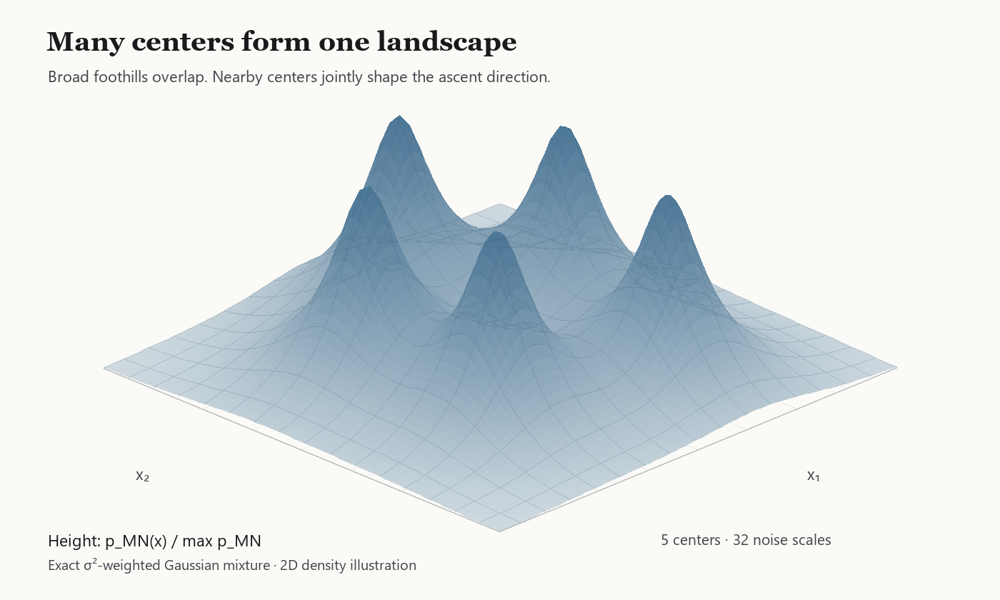

*Figure 5. Contributions from different centers overlap. The mixture can form several peaks and connecting regions. Its modes depend on the combined contributions and need not coincide exactly with the training points.*

The terrain is no longer a collection of independent cones. Broad components overlap, and nearby centers jointly shape the local direction. This interaction is where memorization and generalization will enter the story.

## 5. A neural network learns the slope of the whole landscape

We can now write the density precisely. Use $N$ logarithmically spaced noise levels, sample a training center and a scale index uniformly, and weight the denoising error by $\sigma_i^2$. The noise-unconditioned network, with parameters $\theta$, receives only the perturbed sample:

$$
\mathcal L_u(\theta)=\frac{1}{2MN}\sum_{j,i}\sigma_i^2\,\mathbb E_{X\sim\mathcal N(\mu_j,\sigma_i^2I)}\left\|s_\theta(X)-\frac{\mu_j-X}{\sigma_i^2}\right\|^2.
$$

The expectation $\mathbb E$ averages over the random corruptions of each center. The trainer still knows the center and noise level it used, so it can provide the Gaussian component-score target from Section 3. Hiding the noise level from the network makes this regression average across scales as well.

Completing the square shows that the exact regression target is the score of the unified density

$$
p_{MN}(x)=\frac{1}{Z_{MN}}\sum_{j,i}\sigma_i^2\mathcal N(x;\mu_j,\sigma_i^2I),\qquad Z_{MN}=M\sum_i\sigma_i^2.
$$

The $\sigma_i^2$ factors are part of the density learned by this loss. Uniformly drawing the noise levels does not make this particular mixture unweighted [[1]](https://arxiv.org/abs/2601.19285) [[2]](https://arxiv.org/abs/2611.22202).

Training learns its slope. Generation moves a sample along that slope:

$$
\dot x=\nabla\log p_{MN}(x),\qquad x_{n+1}=x_n+\eta_n s_\theta(x_n).
$$

The dot denotes the rate of change with respect to optimization time. There is no reverse-time noise label in this field. For the exact flow,

$$
\frac{d}{dt}\log p_{MN}(x(t))=\|\nabla\log p_{MN}(x(t))\|^2\ge0.
$$

The landscape stays fixed while the sample climbs it.

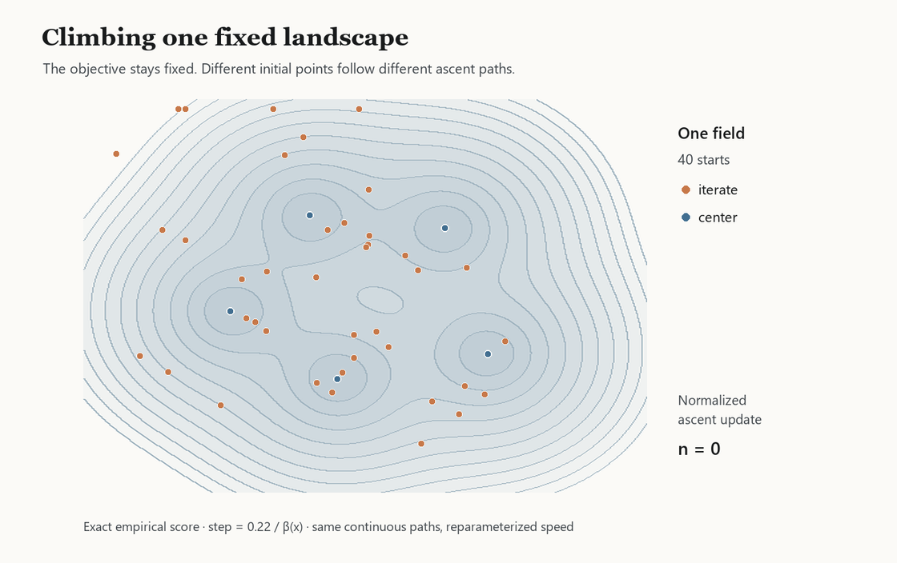

*Figure 6. Different initializations follow the same analytic field. The animation updates the sample along its score with an adaptively scaled step; the exact normalized rule is given below. These finite updates approximate continuous ascent, and density increases in this example. No sampling noise is added during the climb. Pause animations with the control at the top of the reading view.*

The direction has an especially concrete form:

$$
\nabla\log p_{MN}(x)=\beta(x)\bigl(\bar\mu(x)-x\bigr).
$$

Here $\bar\mu(x)$ is a locally weighted average of the centers, and $\beta(x)>0$ sets the speed. Move toward that average. The current state changes the weights, so the same objective can use broad information far away and finer information nearby. This adaptation is a property of the mixture, rather than an externally supplied schedule [[1]](https://arxiv.org/abs/2601.19285) [[2]](https://arxiv.org/abs/2611.22202).

For the precise weights, first let $w_{ij}$ describe how much each center–scale component contributes to the density. The gradient also depends on inverse variance, often called precision. Dividing the density weights by their variances and normalizing gives the weights $\widetilde w_{ij}$ appropriate for the direction:

$$
w_{ij}(x)=\frac{\sigma_i^2\mathcal N(x;\mu_j,\sigma_i^2I)}{\sum_{l,k}\sigma_k^2\mathcal N(x;\mu_l,\sigma_k^2I)}.
$$

The average inverse variance sets the local speed:

$$
\beta(x)=\sum_{j,i}\frac{w_{ij}(x)}{\sigma_i^2}.
$$

The normalized weights for the center average are

$$
\widetilde{w}_{ij}(x)=\frac{w_{ij}(x)}{\sigma_i^2\beta(x)}.
$$

Finally, combine the centers with those weights:

$$
\bar{\mu}(x)=\sum_{j,i}\widetilde{w}_{ij}(x)\mu_j.
$$

For the analytic mixture, a useful discrete update is $x_{n+1}=x_n+\eta(\bar\mu(x_n)-x_n)$. A direct mixture calculation gives an ascent guarantee for $0<\eta<2$. The animations use $\eta=0.22$ for the mountain range and $\eta=0.2$ for the affine-grid example. Such a guarantee concerns the exact objective and update; a learned score still needs to approximate the field accurately where it is used.

Why the normalized exact-mixture step increases density

Put $v=\bar\mu(x)-x$. Using the current component responsibilities $w_{ij}(x)$, Jensen's inequality gives

$$
\begin{aligned}
&\log p_{MN}(x+\eta v)-\log p_{MN}(x)\\
&\qquad\ge \eta\left(1-\frac{\eta}{2}\right)\beta(x)\|v\|^2.
\end{aligned}
$$

The right side is nonnegative for $0<\eta<2$. This calculation uses the exact Gaussian-mixture weights; it does not assume that an arbitrary learned field or an arbitrary Euler step has the same guarantee.

## 6. Optimization needs one more ingredient to become generation

Suppose every climber reaches a beautiful summit. An optimizer might consider the job finished. A generator still has a problem if almost everyone reaches the same summit.

Optimization asks for a good solution. Sampling also asks how probability is distributed among good solutions. Random initialization can provide different outcomes under deterministic dynamics, but randomness at the start alone does not guarantee useful diversity. The set of starting positions flowing to one destination is its attraction basin; one such basin may capture nearly all the initial probability.

We therefore need two properties. **Fidelity** means that the trajectories approach meaningful data geometry. **Diversity** means that different data regions continue to receive probability. Non-memorization adds a further requirement: those outcomes should not simply reproduce the finite training list [[2]](https://arxiv.org/abs/2611.22202).

These properties are related, but none can replace the others. A cloud far from all training examples may be novel and completely invalid. A perfect reconstruction of one training image may be valid and completely useless as a diverse generator.

The fixed landscape makes fidelity a geometric question about its gradients. To understand diversity, we need to connect those paths to probability. Here the same $\sigma^2$ weighting reveals a second role.

## 7. The same field carries probability from broad noise to fine structure

To check diversity, follow many climbers at once and ask how much probability reaches each data neighborhood. The manifold tells us where plausible objects lie; a reference population tells us how often its different regions should occur. We need a connection between that population and the probabilities carried by our ascent paths.

The multi-scale mixture supplies such a connection through a **source–sink balance**. Here flow means probability passing through space when we consider many paths together. A broad Gaussian perturbation supplies the flow, and a fine perturbation receives it. The special $\sigma^2$ weighting makes the intermediate scales cancel, leaving a balance between these two cutoffs along the same fixed field [[2]](https://arxiv.org/abs/2611.22202).

For readers who want the calculation, write the reference population as $Q_{\mathcal M}$ on the manifold $\mathcal M$. This is a theoretical reference for the analysis, not a distribution the generator needs to know. Let $p_\sigma^Q$ be the density obtained by drawing from this population and adding Gaussian noise. In formulas, $p_\sigma^Q=Q_{\mathcal M}*\mathcal N(0,\sigma^2I)$; the convolution symbol $*$ represents that addition of independent noise. Gaussian differentiation gives

$$
\partial_\sigma p_\sigma^Q=\sigma\Delta p_\sigma^Q.
$$

Here $\Delta$ is the sum of the spatial second derivatives, called the Laplacian. Integrating over the scales leaves only the two cutoffs:

$$
\Delta\int_{\sigma_{\min}}^{\sigma_{\max}}\sigma p_\sigma^Q\,d\sigma=p_{\sigma_{\max}}^Q-p_{\sigma_{\min}}^Q.
$$

On a log-spaced schedule, $\sigma^2\,d\log\sigma=\sigma\,d\sigma$. This is the cancellation behind the source–sink balance.

For the actual finite mixture, let $h$ be the spacing between consecutive log noise levels, so $\sigma_i=\sigma_{\min}e^{(i-1)h}$, and put $A_N=h\sum_i\sigma_i^2$. Then

$$
\nabla\cdot\bigl(A_Np_{MN}\nabla\log p_{MN}\bigr)=p_{\sigma_{\max}}^Q-p_{\sigma_{\min}}^Q+\mathcal R_N.
$$

The divergence symbol $\nabla\cdot$ measures net outward flow per unit volume. The residual $\mathcal R_N$ records the finite noise grid and the difference between the empirical and reference distributions. The left side uses the very gradient field we already climb [[2]](https://arxiv.org/abs/2611.22202).

The probability argument below bounds the difference between a distribution of marked locations and $p_{\sigma_{\min}}^Q$ by $\epsilon_{\mathrm{Pois}}+\epsilon_{\mathrm{init}}$ in total variation. Total variation is the largest difference in probability assigned to any region; the two error terms measure the flux residual and initialization mismatch. A useful approximation requires their sum to be small [[2]](https://arxiv.org/abs/2611.22202).

The probability interpretation is easier to picture. Imagine placing a random mark somewhere on each unchanged ascent path, possibly at different times for different climbers. The source–sink argument provides a marking rule whose locations approximately follow the fine Gaussian perturbation, with the errors described above. It links the paths we optimize to a known reference distribution.

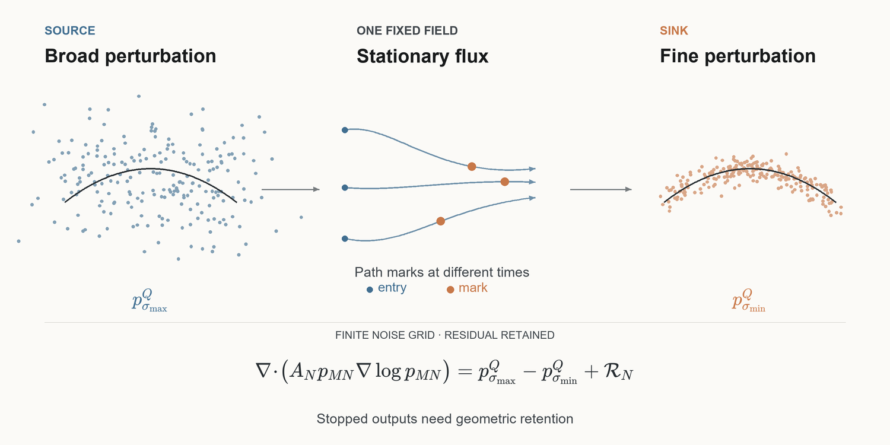

*Figure 7. The source supplies probability and the sink receives it along fixed paths. Marks occur at different times, and the equation's $\mathcal R_N$ retains the finite-grid error. This stationary balance does not identify the optimizer's distribution at one common time with a diffusion distribution.*

To connect the marks to the actual output, the theory stops a trajectory when it first comes within a chosen distance of the manifold. The late refinement segment lies between two such distance neighborhoods. Under the theorem's conditions, the relevant reference mark lies in that segment with high probability, and geometry limits how far the path can subsequently slide along the manifold. Reference probability safely inside a region—after allowing for both the Gaussian perturbation and the later path displacement—is retained at the stopped output, up to the stated errors. This is **finite-resolution regional coverage**. Practical stopping rules still need to approximate the idealized distance-based stop [[2]](https://arxiv.org/abs/2611.22202).

The cutoffs match a familiar diffusion picture: broad perturbation at the beginning, data perturbed by $\sigma_{\min}$ at the fine end. The connection is about transport along the same fixed paths and coverage of the output. It does not assert that ordinary gradient ascent reproduces every diffusion time marginal or exactly samples the fine smoothing at one common stopping time.

This is the bridge between optimization and sampling: convergence supplies destinations; the probability argument controls which regions remain populated.

## 8. Sharp weights explain why generation can memorize

We can now return to the local terrain. At a fixed noise scale, the ratio of the responsibilities of two centers is

$$
\frac{w_{ij}(x)}{w_{i\ell}(x)}=\exp\left(\frac{\|x-\mu_\ell\|^2-\|x-\mu_j\|^2}{2\sigma_i^2}\right).
$$

As $\sigma_i$ becomes small, a modest distance advantage can become an overwhelming weight advantage. The score then points almost entirely toward one training example. Nearby initial states on opposite sides of a competition boundary can be sent toward different examples, producing a sharp local change in the field [[1]](https://arxiv.org/abs/2601.19285).

This gives a geometric account of empirical memorization. With the exact empirical diffusion score, initialization from the corresponding noisy empirical law, and a zero-noise endpoint, the ideal reverse process recovers the empirical training distribution. Perfectly reproducing that target cannot, by itself, create a new population sample [[1]](https://arxiv.org/abs/2601.19285) [[5]](https://arxiv.org/abs/2011.13456).

In practice, a neural network often learns a smoother field than this sharp empirical target. Several nearby training samples continue to influence the direction. Their combined pull can describe a local patch of the data manifold, rather than a single remembered point. Our smoothing study compares analytic and learned scores, including how much an update amplifies a small change in its input. This local amplification is the expansiveness discussed in the paper [[1]](https://arxiv.org/abs/2601.19285).

Noise unconditioning makes such shared influence easier in an important sense: centers are no longer forced to compete only at one prescribed noise scale. At a fixed position, different centers can contribute through different scales. For $d>2$, the unnormalized log weight of a single center–scale component, $-(d-2)\log\sigma-\|x-\mu_j\|^2/(2\sigma^2)$, is maximized, before applying the cutoffs, at

$$
\sigma_{\mathrm{opt}}=\frac{\|x-\mu_j\|}{\sqrt{d-2}}.
$$

A farther center can therefore contribute through a broader component instead of being exponentially suppressed at an unsuitable small scale. The full field still sums over all available scales; the optimal-shell calculation explains its adaptive mechanism [[1]](https://arxiv.org/abs/2601.19285).

This can soften competition and delay single-center collapse. The analysis and experiments support this local mechanism; they do not establish that the unconditioned score changes more gently in every direction everywhere. If the floor is too small, the exact empirical field can still memorize.

Temperature smoothing, introduced in the same study, makes the intervention explicit: divide the competing log weights by a temperature $T>1$ before normalizing them [[1]](https://arxiv.org/abs/2601.19285). This spreads their shares, keeping more neighboring samples involved. We keep the exact fixed-objective theory centered on noise unconditioning, since a temperature-modified proxy field requires separate care about whether it remains the gradient of a scalar density.

## 9. Local geometry decides how much smoothing is safe

Shared influence sounds desirable, but an average of valid samples need not itself be valid. The average of several points on a curved arc generally falls inside the arc. With too much smoothing, the score may pull toward that average and away from the manifold.

The relevant geometric quantity is **reach**, denoted by $\tau$. It is the radius of a neighborhood in which every point has a unique nearest point on the manifold. Larger reach corresponds to gentler local bending and more separation between different folds of the manifold. It gives a larger geometric budget for smoothing [[2]](https://arxiv.org/abs/2611.22202).

**Explore the neighborhood.** [Open the manifold interaction](local-manifold.html) to change curvature, training spacing, and $\sigma_{\min}$. Inspect the weighted average at a chosen point, then follow a fixed set of starts to see whether they approach training points, settle between them, or leave the manifold neighborhood.

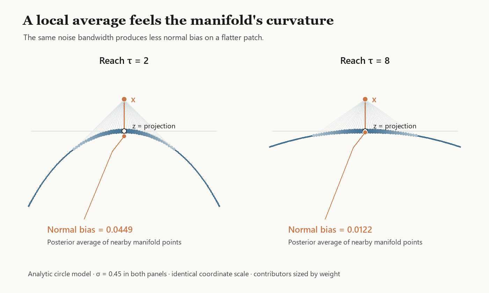

*Figure 8. Gaussian-weighted neighboring points on a curved manifold pull their average slightly inward. A flatter patch has less normal bias at the same bandwidth. Single-scale population quadrature on circles of radii 2 and 8, with $\sigma=0.45$, gives normal biases of approximately 0.0449 and 0.0122. This isolates local averaging; the multi-scale theorem also requires posterior localization and landscape conditions.*

Let $m$ be the manifold dimension. The optimization analysis [[2]](https://arxiv.org/abs/2611.22202) makes three requirements explicit: the active centers stay local, nearby gradients pull toward the manifold, and unwanted distant equilibria are not attractors. Under the stated regularity and initialization conditions, almost every exact trajectory converges within

$$
\operatorname{dist}(x_\infty,\mathcal M)\le\frac{C_{\mathrm{loc}}m}{2\tau}\sigma_{\min}^2.
$$

Here $C_{\mathrm{loc}}$ controls how widely the active centers spread around the nearest manifold point. The assumptions do real work: a very broad mixture can have an attracting point away from a curved manifold, so smoothness and Gaussian perturbation alone are insufficient.

The bound captures a simple competition. The score pulls inward toward the data, while curvature creates a bias in the local average. Greater smoothing increases that bias; larger reach reduces it. Higher curvature therefore tightens the allowable smoothing scale.

A flat line or plane, possibly shifted from the origin, makes the separation especially clear. Such a set is an **affine subspace**, denoted by $\mathcal A$. If all centers lie there, their weighted average lies there too. The perpendicular, or normal, component of the exact flow contracts to zero for every fixed positive schedule. We can retain a positive smoothing floor without requiring a nonzero final distance from that subspace [[2]](https://arxiv.org/abs/2611.22202).

This is the opening needed for a stronger form of generalization.

## 10. A positive noise floor can preserve new outcomes

If the empirical field is made arbitrarily sharp, the training examples can become isolated destinations. If it is smoothed too aggressively, distinct regions can disappear into one broad attraction basin. A useful regime lies between these effects: enough smoothing to suppress sample-level capture, while keeping enough spatial variation to preserve distinct outcomes.

Our optimization study proves that such a regime exists for a particular family of flat geometries. Divide a line into cells of spacing $\ell$, indexed by the integer $k$, and place a pair of observations on either side of each cell center: $\ell(k\pm1/6)$. This interlaced arrangement leaves room for destinations between the observations. For sufficiently large grids with at least two ambient directions normal to the manifold, the construction gives a positive bandwidth window: a range of smoothing scales bounded away from zero. Under the stated Gaussian initialization, endpoints are separated from the training set with high probability, while many cells retain probability. These conclusions apply to the same endpoint law, at the spatial resolution that the training spacing can resolve [[2]](https://arxiv.org/abs/2611.22202).

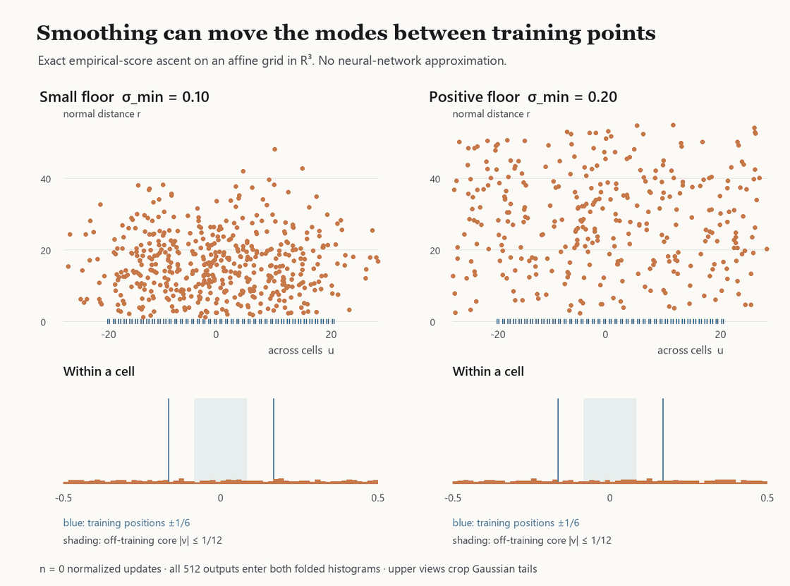

*Figure 9. An analytic finite-grid example in three ambient dimensions compares $\sigma_{\min}=0.10$ and $0.20$ at spacing $\ell=1$. The paired training positions become clear after folding each cell onto the same interval; the upper view keeps the cell identities visible and crops the early Gaussian tails. The folded view and numerical statistics include every output. These normalized-ascent runs illustrate the construction at bandwidths below the theorem's sufficient floor; they are not a numerical proof of it. The upper cutoff and Gaussian initialization scale change with the floor, following the manuscript's fixed relative schedule.*

The construction establishes a possibility that is easy to miss: **an exact empirical score can support non-memorizing optimization outcomes.** We do not have to attribute every new outcome to a neural network's failure to fit the empirical target [[2]](https://arxiv.org/abs/2611.22202).

The guarantee has a resolution. A finite mixture may still send its outcomes to isolated destinations, and avoiding the training points alone does not recover a continuous population. In the construction, the distance margin and coverage scale with the training covering radius: the largest distance in the reference patch to its nearest observation. Along a constructed sequence with suitable bandwidth and probability-error choices, the endpoint laws approach the continuous reference in Wasserstein-1 distance, which measures the smallest average movement needed to transport one law into the other. This average movement can shrink even while each finite model has isolated destinations. Extending the same endpoint guarantee to general curved manifolds remains an open direction [[2]](https://arxiv.org/abs/2611.22202).

The broader geometric lesson is useful even before that extension. A positive floor can keep several centers active. Large reach can let us retain that floor while maintaining normal accuracy. Together they suggest a route from remembering isolated examples toward representing local data variation.

The next illustration fixes $\sigma_{\min}=0.5$ and compares two curvatures at the same training-cell spacing $\ell=1.3$. The near-flat case has reach 50, and the more curved case has reach 1.25. The view magnifies the normal direction as the trajectories approach the manifold, while keeping the different cells visible. Watch both distances: in the near-flat case, the outcomes stay far from the observed points and close to the curve. Curvature makes the same local averaging less accurate in the second case.

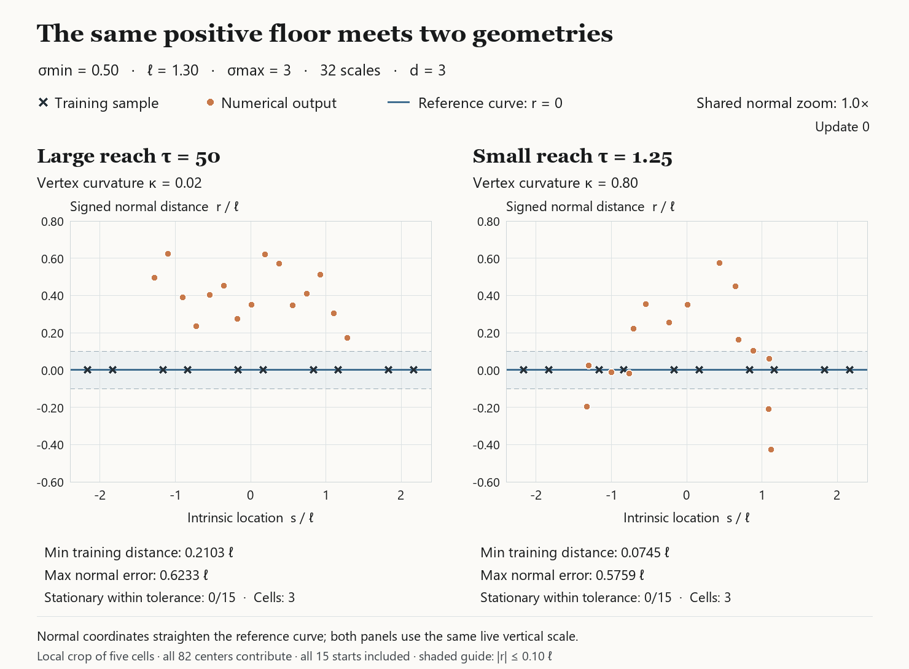

*Figure 10. Exact empirical-score refinement at $\sigma_{\min}=0.5$, with all other mixture settings matched. The horizontal coordinate is distance along the reference curve; the vertical coordinate is normal displacement, with its changing scale labeled. All numerical outcomes enter the diagnostics. Small nonzero curvature gives a small remaining normal bias; the affine limit has zero limiting normal error. These are illustrative finite-cloud results, rather than a proof for arbitrary manifolds.*

## 11. Control becomes a change to the objective

For an application researcher, a generation framework becomes especially useful when the object must satisfy something else: agree with a measurement, obey a physical constraint, or have a desired property.

Control asks us to reach a particular part of the data manifold. Let $\mathcal M_y\subseteq\mathcal M$ denote the region satisfying the task $y$. This constrained region and the rest of the manifold both contain valid data. Guidance tells us which part fits the current request.

Before adding a task, our learned landscape already favors data-like objects. This learned preference is the **prior**. Let $E_y(x)$ be a differentiable penalty for violating a task $y$—for example, squared disagreement with the known pixels in an inpainting problem. Combining the prior with that penalty gives

$$
F_y(x)=\log p_{MN}(x)-\lambda E_y(x).
$$

The nonnegative parameter $\lambda$ sets the task's strength relative to the prior.

The update follows immediately:

$$
x_{n+1}=x_n+\eta_n\bigl[s_\theta(x_n)-\lambda\nabla E_y(x_n)\bigr].
$$

The prior gradient favors plausible data; the penalty gradient favors task satisfaction. An application can specify its requirement in familiar optimization terms. With the exact score, the bracketed vector is the gradient of the displayed objective; whether a finite step increases it depends on the step size. A learned vector field supplies its practical approximation [[2]](https://arxiv.org/abs/2611.22202).

The geometry still matters. Guidance that acts along the manifold is easier to accommodate than a requirement that pushes strongly away from it. Once the guided trajectory enters a manifold neighborhood where its contributing centers remain appropriately local, the analysis bounds how much outward guidance can enlarge that neighborhood [[2]](https://arxiv.org/abs/2611.22202).

Without guidance, either construction can return to the data manifold without favoring the constrained region. Gentle guidance adds a second role: the prior brings the sample toward $\mathcal M$, while the task gradient steers its destination toward $\mathcal M_y$. The first two cases in the illustration show both constructions doing this successfully.

Now follow the complete sampling run. For noise conditioning, the prescribed $\sigma_n$ decreases from $\sigma_{\max}$ to $\sigma_{\min}$ over the full budget of $K$ updates. The solver advances this noise clock after every step, independently of where guidance has moved the sample. Before adding the task force, the schedule describes the noisy distributions the sampler is designed to traverse. In the illustration, the unguided probability-flow step follows the decrease in noise variance: the sample approaches the manifold as its noisy region contracts.

Recall why we introduced Gaussian shells: at a given noise level, most training examples occupy a particular noisy region. Increasing $\lambda$ pulls the path more strongly toward $\mathcal M_y$. Increasing the step size uses fewer, larger updates over the same interval. At the same position and $\lambda$, the task displacement of an update grows with its step size, with fewer intermediate score queries to resolve the motion. Such updates can put the point outside the training region associated with its scheduled $\sigma_n$. This is a **state–noise mismatch**. The Gaussian score still exists there, but the learned network may have to extrapolate. Its error changes the next state again while the prescribed noise level keeps decreasing, allowing the mismatch to accumulate [[1]](https://arxiv.org/abs/2601.19285) [[2]](https://arxiv.org/abs/2611.22202).

Noise unconditioning changes this next query. The network receives the displaced state alone, and the state determines which scales contribute. A point pushed farther from the data can draw on broader perturbations again. As it returns toward the data, finer scales take over. The scale weights carry the state's own implicit noise-level information. Within the mixture's well-covered range, the next prior direction remains supported by the multi-scale training construction, even when the point has left the shell expected by a diffusion schedule [[1]](https://arxiv.org/abs/2601.19285) [[2]](https://arxiv.org/abs/2611.22202).

This adaptation happens throughout sampling. The implicit scale can become coarser after an outward displacement and finer as the sample returns. The prior supplies the return toward the manifold, while the continuing guidance selects its constraint-satisfying region. This is the same overlap-of-shells idea that supplied training coverage in the first place, now helping a controlled trajectory continue when it departs from the scheduled noisy region.

**Explore a complete guided run.** [Open the guidance interaction](guided-shells.html) and start with **No guidance**, then **Gentle guidance**. Follow the two paths from the same initialization, and watch the scheduled noise level decrease all the way to $\sigma_{\min}$. Then increase the guidance or choose **Coarse steps**: the update count decreases as the step size grows, and the left path illustrates accumulated score error after leaving its scheduled training band. The right-hand implicit scale follows the sample's position while its score and guidance continue steering toward $\mathcal M_y$. The paths illustrate the mechanism rather than measured neural-network performance.

The two toy solvers use different numerical scalings, and the off-band error is prescribed. Their paths illustrate mechanisms rather than a matched numerical benchmark.

This distinction separates the quality of a score query from the choice of a sampling step. Within the multi-scale training region, the state-only score can remain appropriate after a displacement even when a prescribed diffusion label no longer fits. An overly large optimization step can still overshoot, but the next query can again use the sample's actual position. The fixed-field update combines this score with guidance throughout the trajectory.

The reported experiments test the practical promise with learned models. In a synthetic task with four disk-shaped data regions, guidance selects one desired disk. With penalty strengths tuned separately over the same validation candidates, 100 main steps achieve 96.1% target success for the unconditioned model and 73.7% for the conditioned model. The unconditioned model also uses 20 unguided refinement calls, giving 120 total model evaluations versus 100. In a CIFAR-10 cat–dog augmentation experiment with only 100 real minority-class cats, unconditioned augmentation reaches 65.33% balanced accuracy—the average of cat and dog accuracy—compared with 59.75% for diffusion augmentation and 55.38% for repetition. These are results in the reported settings; direct noise-input removal does not improve image quality uniformly across architectures [[2]](https://arxiv.org/abs/2611.22202).

## 12. A simpler entry point into Gaussian denoising generation

We started with an unknown data distribution and a finite list of observations. The list supplies examples of where we want to arrive, but little guidance for a journey that begins far away. Gaussian perturbations extend the useful training region. Their overlapping shells supply examples along the journey, from broad initial noise to the data's fine structure.

Noise conditioning organizes these scales into a sequence of denoising fields. Noise unconditioning combines them into one learned landscape. A single center builds a mountain; overlapping centers build a terrain whose local slopes can represent more than one remembered example.

From there, each additional question has a concrete place. Optimization explains how the sample moves. Manifold geometry explains where it can converge. The source–sink balance connects the same paths to regional probability. Smoothing determines whether local neighborhoods remain shared or become dominated by individual observations. A task penalty changes which directions are desirable, while the state-dependent scale weights let the prior respond to the sample's actual position.

This gives application researchers an entry point that begins with geometry and ordinary gradients. The stochastic-process account remains a powerful way to analyze diffusion. The fixed-landscape account makes a parallel Gaussian denoising generator accessible through a picture we can draw, simulate, and reason about: many climbers, one terrain, and enough distinct destinations to make the climb generative.

## A note on the illustrations

The illustrations play three roles, with different kinds of evidence.

- **Analytic calculations.** Gaussian radial laws, mass–volume relations, finite-mixture densities, exact scores, and local center weights follow explicit formulas. Their plots have ordinary floating-point error; continuous-manifold averages also involve numerical quadrature. These calculations do not require a trained neural network.

- **Numerical experiments.** The ascent animations, curvature comparisons, manifold interactions, and bandwidth examples apply stated updates to analytic models. Their trajectories and diagnostics are reproducible toy-model calculations. Finite steps approximate continuous flows; individual examples do not prove general claims about memorization or generalization.

- **Scenario illustrations.** The training-coverage paths and source–sink picture include conceptual schematics. The guided comparison combines analytic prior and task gradients with chosen damping, schematic training bands, and an intentionally constructed off-band error field. These paths illustrate possible state–noise mismatch and error accumulation; they are scenario simulations, not measured trajectories from trained generators. The source–sink identity has a theoretical basis, including the stated residual; its diagram does not simulate the theorem's marking construction.

High-dimensional shell drawings are radial sections; landscape views use the stated low-dimensional models or invariant slices. They are not projections of typical high-dimensional sampling paths.

The programmed scenarios can be reproduced from the source; reproducing the papers' neural-network experiments is a separate task. Formal guarantees remain those proved in the papers, under their stated assumptions. The visuals explain their mechanisms and scope.

## References and further reading

1. Xinyu Zhou, Jiawei Zhang, and Stephen J. Wright. *[Smoothing the Score Function to Enhance Generalization in Diffusion Models](https://arxiv.org/abs/2601.19285).*
2. Xinyu Zhou, Jiawei Zhang, and Stephen J. Wright. *[An Optimization Framework for Denoising Generation](https://arxiv.org/abs/2611.22202).*
3. Yang Song and Stefano Ermon. *Generative Modeling by Estimating Gradients of the Data Distribution.* NCSN, 2019. [Paper](https://arxiv.org/abs/1907.05600).
4. Jonathan Ho, Ajay Jain, and Pieter Abbeel. *Denoising Diffusion Probabilistic Models.* 2020. [Paper](https://arxiv.org/abs/2006.11239).
5. Yang Song et al. *Score-Based Generative Modeling through Stochastic Differential Equations.* 2021. [Paper](https://arxiv.org/abs/2011.13456).
6. Aapo Hyvärinen. *Estimation of Non-Normalized Statistical Models by Score Matching.* 2005. [Paper](https://jmlr.org/papers/v6/hyvarinen05a.html).
7. Pascal Vincent. *A Connection Between Score Matching and Denoising Autoencoders.* 2011. [Paper](https://doi.org/10.1162/NECO_a_00142).

*The quantitative image-model results above are reported in the papers linked here; they are separate from this blog's toy calculations and scenario illustrations.*

## Scope and attribution

This blog develops an optimization view of generation primarily through our own papers [[1]](https://arxiv.org/abs/2601.19285) [[2]](https://arxiv.org/abs/2611.22202) and a small set of closely related foundational works. It is not a comprehensive literature survey. Related viewpoints, techniques, and conclusions may appear in other papers, sometimes under different terminology. For broader context, please consult the related-work sections of our papers and explore the wider literature. The selected references reflect the scope of this exposition, not a claim of exhaustive coverage or exclusive priority.
